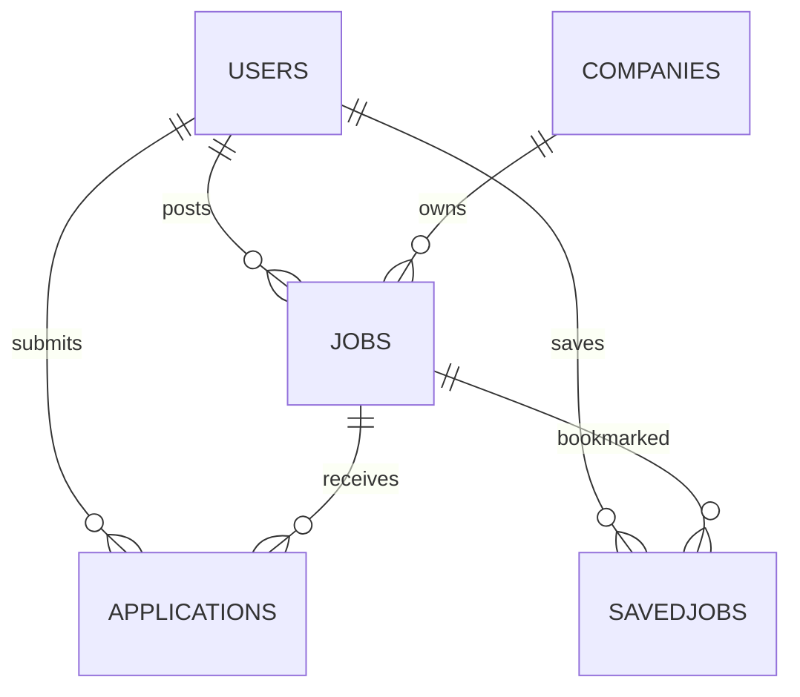

# JobBoard Pro

A full-stack job portal built with **Node.js, Express, MongoDB, HTML, CSS and JavaScript**. It is designed as an academic MongoDB project and demonstrates schema design, CRUD, text search, aggregation pipelines, indexing, and query-plan comparison.

## 1. Features

- Candidate and employer registration/login (JWT authentication).
- Browse, search and filter open jobs.
- Candidate job applications, saved jobs and application tracking.
- Employer job posting, editing/deleting API endpoints, and application status management.
- Admin analytics dashboard.
- MongoDB text search for job title, description, category and skills.
- Six aggregation endpoints.
- Compound and text indexes, plus an `explain()` comparison.
- Seed script creates more than 1,000 job documents.

## 2. Technology

- Frontend: HTML5, CSS3, vanilla JavaScript
- Backend: Node.js + Express
- Database: MongoDB with Mongoose
- Authentication: JSON Web Token + bcrypt
- Deployment target: Render (web service) + MongoDB Atlas M0

## 3. Database schema and design

There are five collections:

| Collection | Important fields | Relationship |
|---|---|---|
| users | name, email, password, role, skills | One user can post many jobs or submit many applications |
| companies | name, industry, location, owner | One company can have many jobs |
| jobs | title, description, category, salary, company, postedBy | References companies and users |
| applications | job, candidate, status, appliedAt | References jobs and users |
| savedjobs | candidate, job, savedAt | References users and jobs |

### Embedding vs referencing justification

- **Referenced:** `jobs.company`, `jobs.postedBy`, and application `job`/`candidate` use ObjectIds. Company, user, and job data are shared and can change independently; referencing avoids repeating large documents.
- **Embedded:** `jobs.skills` and `users.skills` are small arrays of simple values. They are commonly read with their parent document and do not need their own collection.
- **Saved jobs:** a separate collection is used because the candidate-job relationship is many-to-many and needs a unique compound index.

### Schema diagram



## 4. MongoDB concepts demonstrated

### CRUD
- Create: register, create job, submit application, save job.
- Read: job listing, job details, candidate applications, analytics.
- Update: edit job and update application status.
- Delete: delete job.

### Indexes
Defined in Mongoose models:
- `jobs`: text index on `title`, `description`, `category`, `skills`.
- `jobs`: compound index `{ location: 1, category: 1, status: 1 }`.
- `jobs`: descending `createdAt` index.
- `applications`: unique `{ job: 1, candidate: 1 }` and `{ status: 1, appliedAt: -1 }`.
- `savedjobs`: unique `{ candidate: 1, job: 1 }`.

The admin analytics endpoint `/api/analytics/explain` compares:
- Before: forced collection scan using `$natural`.
- After: compound index using `location_1_category_1_status_1`.

It reports execution stage, documents examined and execution time. Run it on the same seeded dataset and explain that timings can vary by machine/cache.

### Aggregation pipelines (6)
1. `/api/analytics/jobs-by-category`: `$match`, `$group`, `$sort`.
2. `/api/analytics/application-status`: `$group`, `$sort`.
3. `/api/analytics/top-jobs`: `$group`, `$sort`, `$limit`, `$lookup`, `$unwind`, `$project`.
4. `/api/analytics/monthly-trend`: `$group` with `$year` and `$month`, then `$sort`.
5. `/api/analytics/company-jobs`: `$group`, `$lookup`, `$unwind`, `$project`, `$sort`, `$limit`.
6. `/api/analytics/salary-by-location`: `$match`, `$group`, `$sort`, `$limit`.

### Advanced feature: MongoDB text search
`GET /api/jobs?q=data analyst` uses the MongoDB text index. It searches job title, description, category and skills.

## 5. Run locally in VS Code

### Prerequisites
Install Node.js LTS and MongoDB Community Server, or create a free MongoDB Atlas M0 cluster.

### Steps
1. Extract the project ZIP and open the `JobBoard-Pro` folder in VS Code.
2. Open the VS Code terminal in that folder.
3. Install dependencies:

   ```bash
   npm install
   ```

4. Copy `.env.example` to `.env`.
5. Put your MongoDB connection string in `MONGODB_URI`. For local MongoDB, the example URI is:

   ```env
   MONGODB_URI=mongodb://127.0.0.1:27017/jobboard_pro
   ```

   For Atlas, use the connection string from your Atlas cluster and replace the username/password placeholders. Do not commit `.env`.

6. Set a long random value for `JWT_SECRET`.
7. Seed the database:

   ```bash
   npm run seed
   ```

   This clears the five project collections and recreates demo users, 12 companies, 1,100 jobs and application records. **Do not run seed on a database containing real data.**

8. Start the server:

   ```bash
   npm run dev
   ```

9. Open `http://localhost:5000`.

### Demo accounts

All demo accounts use password `Password123`.

| Role | Email |
|---|---|
| Admin | admin@jobboardpro.com |
| Employer | employer@jobboardpro.com |
| Candidate | candidate1@example.com |

Change demo passwords and remove seeded accounts before any public/real deployment.

## 6. API overview

| Method | Endpoint | Purpose |
|---|---|---|
| POST | `/api/auth/register` | Register |
| POST | `/api/auth/login` | Login |
| GET | `/api/jobs` | List/search/filter jobs |
| GET | `/api/jobs/:id` | Job detail |
| POST | `/api/jobs` | Create job (employer/admin) |
| PUT | `/api/jobs/:id` | Update job (owner/admin) |
| DELETE | `/api/jobs/:id` | Delete job (owner/admin) |
| POST | `/api/jobs/:id/save` | Save job (candidate) |
| POST | `/api/applications` | Apply |
| GET | `/api/applications/mine` | Candidate's applications |
| GET | `/api/applications/employer` | Employer applications |
| PATCH | `/api/applications/:id/status` | Update status |
| GET | `/api/analytics/*` | Analytics and explain endpoints |

## 7. Deploy on Render + MongoDB Atlas

1. Push this folder to a **public GitHub repository**.
2. Create a free MongoDB Atlas M0 cluster, create a database user and allow your deployment IP/network access. Use a strong password.
3. In Render, create a **Web Service** connected to the GitHub repository.
4. Build command: `npm install`
5. Start command: `npm start`
6. Add environment variables in Render:
   - `MONGODB_URI` = Atlas connection string
   - `JWT_SECRET` = long random secret
   - `NODE_ENV` = `production`
7. Run `npm run seed` once against the Atlas database (locally with the production URI, or through a one-off shell if available). Do not repeatedly seed a live database.
8. Open the Render URL and test login, search, application and analytics.

Free-tier availability and limits can change. Confirm current provider terms before submission.

## 8. GitHub commit plan

Make genuine commits as you complete each milestone; do not create fake historical commits.

1. `chore: initialize JobBoard Pro project`
2. `feat: add MongoDB schemas and indexes`
3. `feat: implement authentication and job CRUD`
4. `feat: add applications and saved jobs`
5. `feat: add aggregation analytics and explain comparison`
6. `feat: build responsive frontend`
7. `docs: add schema diagram and deployment guide`

## 9. Suggested demo / viva sequence

1. Show the five MongoDB collections and explain references vs embedded arrays.
2. Register/login as candidate; search and apply for a job.
3. Login as employer; create a job and update an application status.
4. Login as admin; show analytics and six aggregation endpoints.
5. Explain text search and show `explain()` before/after index results.
6. Show 1,100+ job documents and explain the compound index.

## 10. Important project limitations / next improvements

This is an academic starter project. Before production use, add request rate limiting, stronger input validation, secure cookies or token refresh, resume file upload/storage, email verification, pagination controls in the UI, and automated tests. The employer demo uses the first seeded company when creating a job; a full company onboarding screen can be added as an extension.
